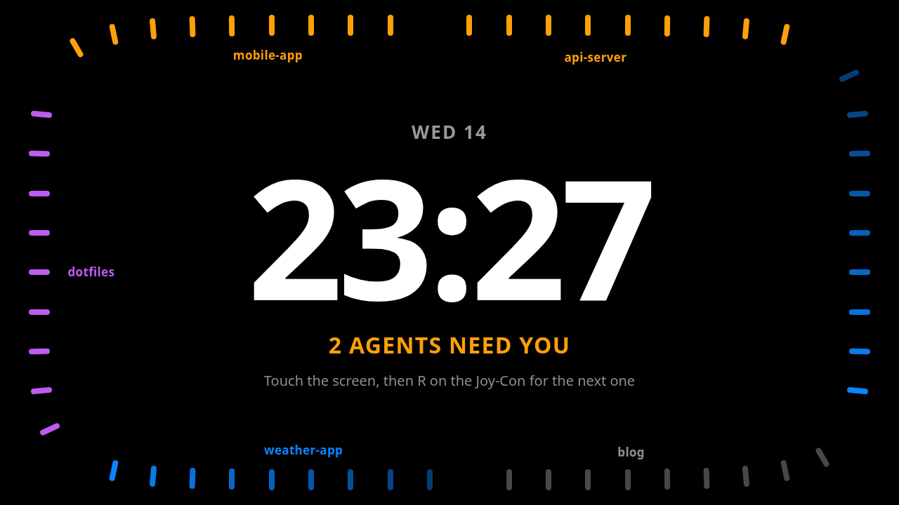
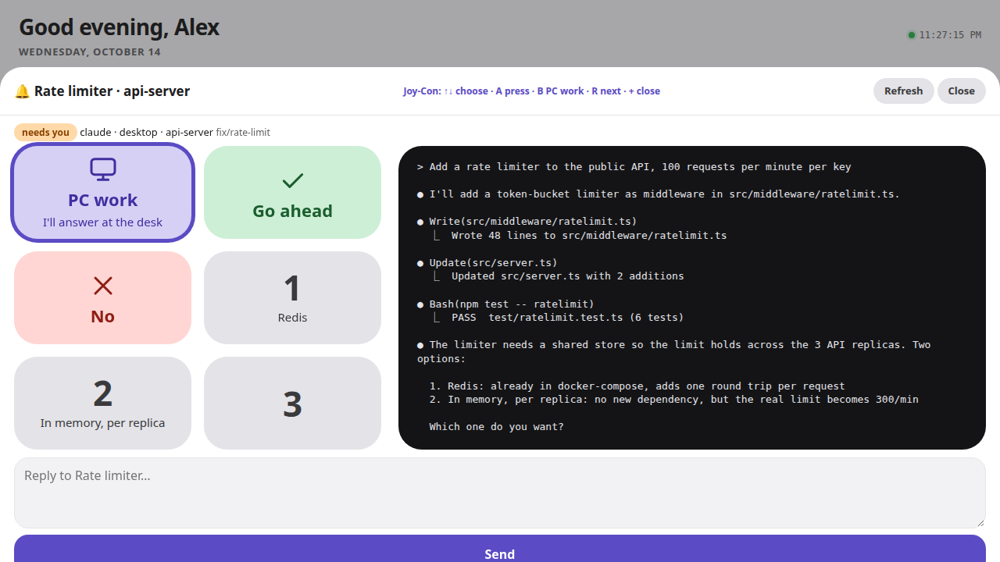
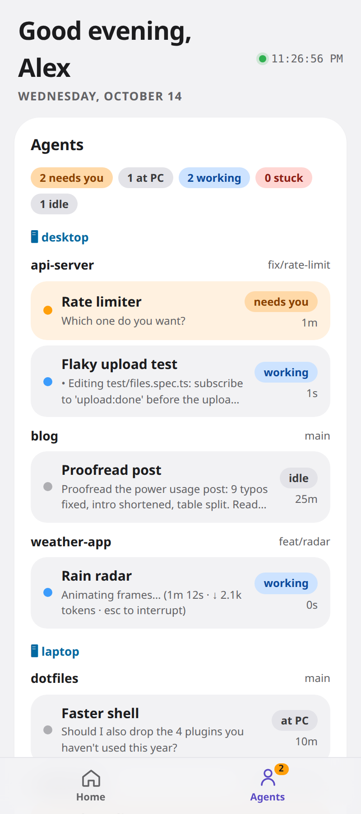
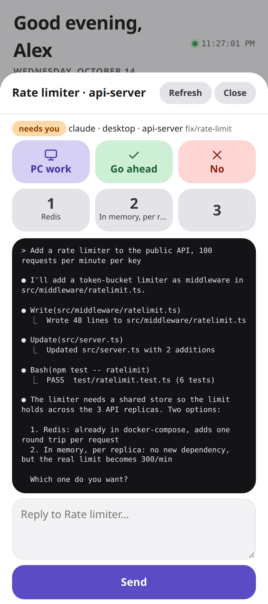
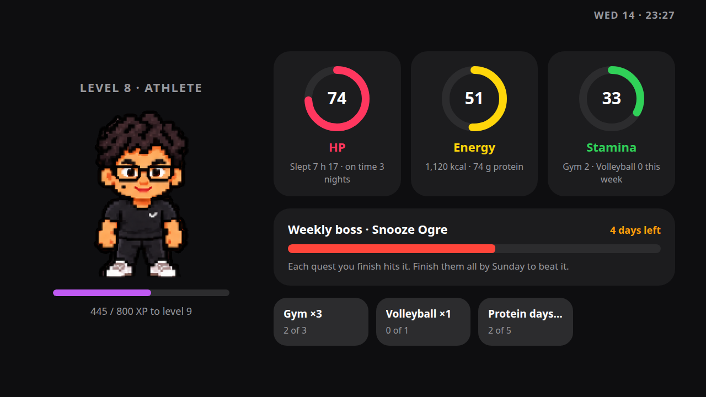
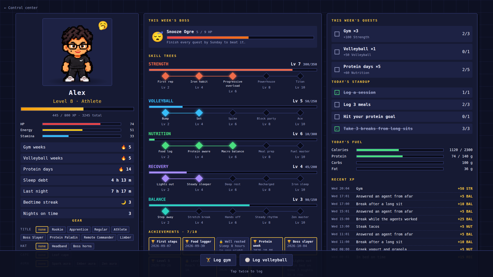
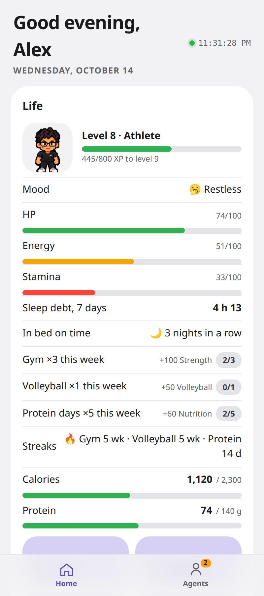

# cooldownd

**Keep your agents moving and your body healthy.** cooldownd is a control room for developers who run AI coding agents all day.

Agents stall the moment they need you, so you stay glued to the desk to answer them, and your sleep, meals and workouts pay for it. cooldownd puts your agents on a touchscreen, your phone and a pair of Joy-Cons, so you can answer one from the kitchen or between sets. It also turns your workouts and meals (and your sleep, once you feed it in) into an RPG, so looking after yourself feels like part of the job.

It's one Python panel, standard library only. It runs on a Raspberry Pi, your workstation and a jailbroken Nintendo Switch, all on your tailnet. There's no cloud, no app store and no build step. The phone app is the panel added to your Home Screen, and its alerts are Web Push sent by the panel itself.

<p align="center"></p>

## Your agents

Every coding agent (Claude Code, Codex…) running in your terminals shows up live, by machine and project: who needs you, who's working, who's stuck, who's idle. When one starts waiting on you:

- **The touchscreen chimes and opens it**, with big answer tiles next to its terminal: PC work, Go ahead, No, and 1/2/3 with the option's text.
- **The Joy-Cons answer it:** ↑/↓ choose, A presses, B means "I'll handle it at the PC", R jumps to the next waiting agent. The highlight starts on PC work, the safe answer.
- **Your phone gets a push alert** after a minute, and opens the same screen, where you can also type a reply.
- **"PC work" sets a question aside** without answering it, and it stops paging until the question changes.

The pager never retries text that may already have arrived, and never types into an agent that's busy or stuck.

<p align="center"></p>

### Agent health

The workstation keeps a log of what its agents do, so you see more than who's waiting right now:

- **Time blocked on you:** the minutes each agent spent waiting for an answer, per day.
- **Stuck agents:** working, but the screen hasn't changed in 10 minutes, or the same error keeps coming back. You get one alert.
- **Ready to review:** when an agent finishes a task, its recap goes in a queue with one alert, instead of you finding it hours later.
- **Usage limits:** Claude Code's usage-limit banner sends an alert.
- **Tokens today**, read from Claude Code's transcripts on that machine (numbers only, never their text).
- **Forgotten agents:** terminals idle for more than two days.
- **A daily report** with all of the above.

<p align="center">
  
  &nbsp;
  
</p>

## You and your agents

The workstation also knows when you're at the keyboard (GNOME's idle monitor), so the two halves meet:

- **Desk time:** a sitting timer. After 50 minutes at the keyboard it reminds you to stand up; a 3-minute break ends the stretch.
- **"Your agents are busy: move."** When two or more agents are working and none is waiting on you for 20 minutes, it's a good moment for a walk or a set. You get one nudge, and a break taken then earns bonus XP.
- **XP for leaving the desk:** answering an agent from the phone or the Switch while your keyboard is idle earns Balance XP, and so do breaks after a long sit.
- **Night mode:** after your bedtime the Switch stays quiet and doesn't open agents, and phone alerts are held for one summary when you wake up. No desk activity between bedtime and wake counts as a night in bed on time, with a streak.

Every threshold is configurable, and the daily XP from these is capped.

## Your body

The Life RPG turns looking after yourself into XP:

- **Log a workout with one tap:** gym and volleyball out of the box. The activities are config: add running, swimming or climbing in a few lines.
- **Log a meal with a photo or a sentence.** Claude (Haiku, with Sonnet when unsure) estimates the items, calories and protein, and you can correct it in plain words. It learns from your corrections.
- **HP, Energy and Stamina:** HP from your sleep, Energy from today's meals and protein, Stamina from this week's training. Your avatar's mood follows them. Sleep debt shows once you log nights (by hand for now; a Fitbit import is wanted).
- **Levels, skill trees, weekly quests and streaks**, plus a **weekly boss** that every finished quest hits; beat it by Sunday for bonus XP.
- **Achievements, titles and gear** (hats, capes, auras) unlocked as you go.
- **Your agents join your party** on the game screen, each with a level from the tasks it finished.
- **Co-op:** share a weekly quest board with friends who run cooldownd, over Tailscale (off until you set it up, below).
- Everything is computed from stored events, so changing a rule rescores your whole history.
- **Your avatar.** Draw or generate your own sprite sheets; with them, it wears what you did today (gym clothes after the gym, the jersey after a match). Without them, a drawn pixel avatar stands in.
- **Docked to a TV**, the Switch shows the game full screen.

<p align="center"></p>
<p align="center"></p>
<p align="center"></p>

## Your machines

- **One codebase, many panels.** Each machine runs `admin/app.py` (Python standard library only; phone alerts also need `python3-cryptography`) with its own config. A panel can show any other panel's cards (`"desk.agents"` is the workstation's agents card, shown on the Pi), and taps, sheets and actions are forwarded to the panel that owns them.
- **Your PCs.** CPU, GPU, temperatures, wall power against the PSU, services you can restart, a fixed list of commands (never a free shell), Wake-on-LAN from the always-on Pi, and Sleep.
- **The Pi.** Temperature graph, throttling and under-voltage flags, fan, 5 V supply, NVMe, a Docker stack with Home Assistant (lights, alarm, cameras), and uptime checks for your servers with phone alerts when one goes down.
- **A Nintendo Switch as the house touchscreen.** Switchroot Ubuntu in kiosk mode on a USB-C stand: the agent pager and your home, as tinted tiles. After a minute untouched it shows an ambient face you can read from across the room: the agents face (a big clock ringed by your agents' status) or the body face; tap the date to switch. Docked to a TV, it shows the game instead.

## How it fits together

```
 iPhone (Home Screen web app, Web Push)
   │
   ▼            tailnet only (tailscale serve, never funnel)
 Raspberry Pi ── main panel, always on: Home Assistant, uptime, Life RPG, Wake-on-LAN
   │   ▲
   │   └──── Nintendo Switch ── kiosk touchscreen + Joy-Con pager; game screen when docked
   ▼
 Workstation ── its own panel: hardware, services, coding agents
```

Every panel listens on `127.0.0.1` and is published with `tailscale serve`, which adds the `Tailscale-User-Login` header that gates every request. Panels call each other with a shared token (`~/.config/homelab-admin/hub-token`, mode 600), so a tagged device with no user, like the Switch, can still use them. The token gives full control, not just reading: see the security model.

## Quick start

On each machine, with Python 3.10 or newer and Tailscale:

```bash
git clone https://github.com/Slcarvajal/cooldownd ~/homelab
cd ~/homelab/admin
cp config.example.json config.json        # config.pi.example.json on the Pi, config.hub.example.json on a kiosk
$EDITOR config.json                        # allowed_users: your Tailscale login; machines, services, commands
python3 app.py                             # listens on 127.0.0.1:8095 (a plain local visit gets 403: no login)
tailscale serve --bg --https=8443 http://127.0.0.1:8095
```

Then open `https://<machine>.<your-tailnet>.ts.net:8443`. To keep it running, add a user service:

```ini
# ~/.config/systemd/user/homelab-admin.service
[Unit]
Description=cooldownd panel
[Service]
WorkingDirectory=%h/homelab/admin
Environment=ADMIN_CONFIG=%h/homelab/admin/config.json
ExecStart=/usr/bin/python3 -I %h/homelab/admin/app.py
Restart=on-failure
[Install]
WantedBy=default.target
```

```bash
systemctl --user enable --now homelab-admin
loginctl enable-linger $USER              # keep it running when you're logged out
```

Setting up each piece:
- **Raspberry Pi** (Home Assistant stack, Pi health card): [`pi/README.md`](pi/README.md)
- **Nintendo Switch kiosk** (Switchroot, Joy-Cons, game mode): [`switch/README.md`](switch/README.md)
- **Phone alerts:** open the Pi panel from its Home Screen icon (iOS 16.4+), then Machine → Phone alerts → **Turn on alerts on this device**. Needs `python3-cryptography` on the Pi.
- **Meal estimates:** an Anthropic API key in `~/.config/homelab-admin/anthropic-key` (mode 600) on the panel that runs `life`.
- **Night mode:** add `"night"` to the Pi's and the kiosk's configs (keep both the same).
- **Co-op (optional):** on the Pi, add `"coop"` to its `modules`, run the panel with `SHARE_PORT=8097` in its service and publish it with `tailscale serve --bg --https=8444 http://127.0.0.1:8097` (never funnel). Share the Pi with a friend's tailnet and limit their access to that port in your ACLs. Then `python3 -I admin/modules/coop.py add <friend>` prints their token once; they put your URL and that token in their `~/.config/homelab-admin/friends.json` (mode 600): `{"you": {"url": "https://pi.your-tailnet.ts.net:8444", "token": "…"}}`.
- **Your avatar:** draw or generate 4×4 sprite sheets and cut them with [`admin/life/make_sprites.py`](admin/life/make_sprites.py). Without them, a drawn pixel avatar stands in.

## Configuration

Everything is in the panel's JSON config; the examples in `admin/` cover each key. The main ones:

| Key | What it does |
|---|---|
| `name`, `title` | Your name for the greeting; the page title |
| `allowed_users` | Tailscale logins allowed in |
| `hosts` | Extra host names the panel answers to, besides loopback and `*.ts.net` (e.g. your own domain) |
| `modules` | Cards to show, in order. `"<remote>.<module>"` shows another panel's card |
| `remotes`, `remote_modules` | Other panels' URLs, and the title and tab of their cards here |
| `tabs`, `titles` | Move or rename a card |
| `machines` | PCs to wake (MAC, broadcast) and sleep (through their own panel) |
| `services`, `commands` | systemd units to watch or control, and the fixed commands you can run |
| `ha` | Home Assistant URL and token file |
| `uptime` | URLs to check every minute, with the status and text you expect |
| `notify` | The panel URL alerts open, and how long an agent waits before your phone buzzes |
| `life` | Your name and food context, activities (`label`, `emoji`, `skill`, `xp`, `per_week`, `quest_bonus`), skills, sprite folder, `sleep_hours` (8), `coop` (board name, party goal) |
| `agenthealth` | On the workstation: minutes before an agent counts as stuck (`stuck_min`), when a finished task counts (`finish_after_s`), `forgotten_days`, how long the keyboard must be idle for an answer to count as away (`away_idle_s`), `tokens` |
| `presence` | On the workstation: `sit_min` (50), `break_min` (3), `active_idle_s`, and the "agents busy" nudge: `busy_after_min` (20), `busy_min_working` (2) |
| `night` | `{"bedtime": "23:30", "wake": "06:30"}` on the Pi and the kiosk: quiet hours and nights in bed on time |
| `bridge` | On the Pi: which remote is the workstation (`remote`), and how old an event may be and still alert (`fresh_s`) |
| `game` | On a kiosk: the game page to show when docked to a TV |
| `screen_pin` | On a kiosk: actions (`"module/action"`) that need a PIN at the screen |
| `psu_watts` | The workstation's power supply, for the PSU load bar (550) |

A Life RPG with running and swimming:

```json
"life": {
  "name": "Alex",
  "food_context": "Lisbon, Portugal",
  "activities": {
    "run":  {"label": "Run",  "emoji": "🏃", "skill": "endurance", "xp": 40, "per_week": 3, "quest_bonus": 80},
    "swim": {"label": "Swim", "emoji": "🏊", "skill": "endurance", "xp": 50, "per_week": 1, "quest_bonus": 50}
  }
}
```

## Modules

Each card is a file in `admin/modules/` that provides `NAME`, `TITLE`, `TAB` and `card(cfg)`, plus any of `ACTIONS`, `SHEETS` (bottom sheets), `FILES` (images, JSON), `PAGES` (full-screen pages), `UPLOADS` and a background `sample(cfg)`. The contract is at the top of `admin/app.py`.

| Module | Card |
|---|---|
| `overview` | The workstation at a glance: temperatures, power, agent counts |
| `agents` | Coding agents by machine and project; the pager (Orca adapter today, see below) |
| `machine` | CPU, GPU, temperatures, wall power vs PSU, alerts |
| `pi` | Raspberry Pi health |
| `power` | Wake-on-LAN and Sleep |
| `services`, `commands` | systemd units; a fixed list of commands |
| `tailnet` | Your devices on the tailnet |
| `ha` | Home Assistant: alarm, lights, cameras, switches |
| `uptime` | Server checks with alerts |
| `notify`, `webpush` | Phone alerts, with no app (RFC 8291 encryption, VAPID) |
| `life` | The Life RPG and its full-screen game (rules beyond the basics live in `rpg.py`) |
| `agenthealth` | Agent health on the workstation: time blocked on you, stuck, ready to review, limits, tokens (`tokens.py`), forgotten agents, daily report |
| `presence` | Desk time: sitting timer, breaks, the "agents busy" nudge (GNOME idle via `idle.py`) |
| `bridge` | On the Pi: pulls the workstation's event log (`agentlog.py`) into Life XP and alerts; night hold (`night.py`) |
| `coop` | On the Pi: the shared weekly quest board |

## Security model

Read this before you run it.

- **The panel controls your machines.** It types into your agents, restarts services, runs its commands and sleeps PCs. It's only as safe as who can reach it.
- **Tailnet only.** Publish it with `tailscale serve`, **never `tailscale funnel`**. Every request must carry a `Tailscale-User-Login` in `allowed_users`, or the shared hub token. Anyone on your tailnet whose login isn't listed gets a 403.
- **Every local process is trusted.** The panel listens on `127.0.0.1` and trusts the login header `tailscale serve` adds, so any program or user on the same machine can send that header too, including containers with host networking (Home Assistant on the Pi). Run panels on machines whose local users and software you trust.
- **The hub token is full control.** Any panel holding it can run every action on every panel. It sits on the kiosk, which logs in by itself; if you lose the device, make a new token (`python3 -c "import secrets; print(secrets.token_hex(16))"`), put it in `~/.config/homelab-admin/hub-token` on every panel you keep, and remove the lost device from your tailnet.
- **Only known host names are answered** (loopback, `*.ts.net`, config `hosts`), so a web page can't reach a panel through DNS rebinding.
- **The kiosk's screen port has no login, on purpose.** `SCREEN_PORT` listens on `127.0.0.1` only, for the touchscreen itself, so whoever stands at the Switch has full control. Keep that in mind for guests.
- **Secrets stay out of git**, in mode-600 files under `~/.config/` (hub token, Home Assistant token, VAPID key, Anthropic key). Data stays on the machine under `~/.local/share/homelab-admin/`.
- **Actions only accept same-origin requests** (`Sec-Fetch-Site`), so another site can't trigger them.
- **The bridge only pulls.** The Pi reads the workstation's event log with the hub token; the workstation never writes to the Pi, and no action gives XP over HTTP except logging a session, a meal or a night by hand.
- **Co-op never uses the hub token.** It runs on its own `SHARE_PORT` listener that answers one read-only request, `GET /share/v1/week`, with a whitelisted summary (name, level, title, quests, boss: no meals, sleep or agents). Each friend gets their own share token; only its SHA-256 is stored. Friends are read with a separate HTTP client that only talks https to `*.ts.net`, follows no redirects and caps the answer size.
- **Token counts, not transcripts.** `tokens.py` reads Claude Code's local transcripts for usage numbers only; no text is stored or logged.

Found a hole? See [SECURITY.md](SECURITY.md).

## Contributing: adapters wanted

cooldownd grew around one person's machines. Its best future is other people's: other agent IDEs, other consoles and handhelds, other sports and data sources. **See [CONTRIBUTING.md](CONTRIBUTING.md)**. The most wanted:

- **Agent adapters:** [T3 Code](https://github.com/pingdotgg/t3code), Cursor, Zed, Windsurf, VS Code terminals, plain tmux. Today the pager speaks to [Orca](https://github.com/stablyai/orca)'s CLI.
- **Device ports:** PS Vita, PSP, Switch Lite / OLED / Switch 2, Steam Deck, Wii U GamePad, old Android tablets, Kindles. Anything with a browser and a screen can be a room's touchscreen.
- **Data sources:** Fitbit, Garmin, Strava, Apple Health (via Shortcuts), Oura, Withings.
- **Sprite packs** and new skill trees.

## License

[MIT](LICENSE).
